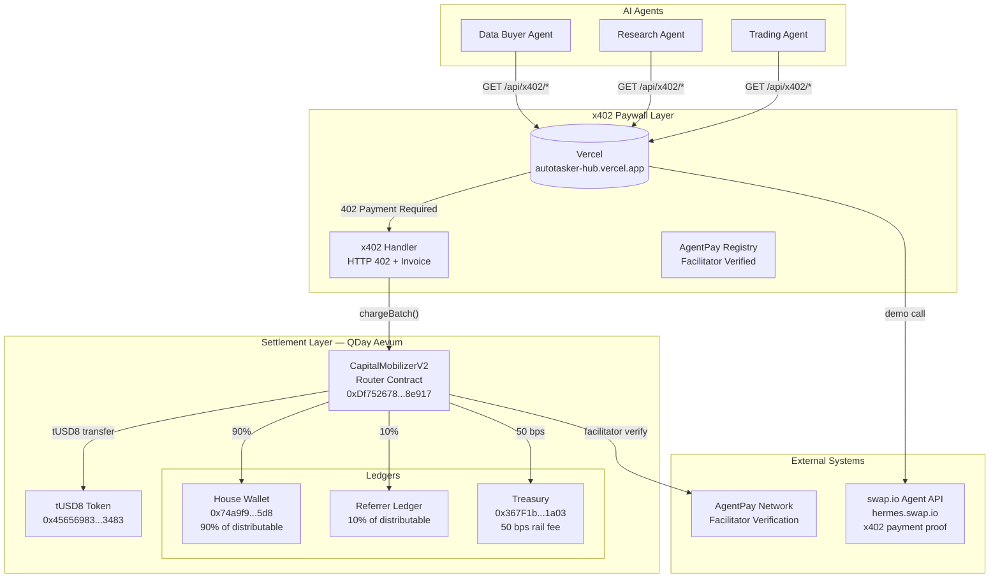
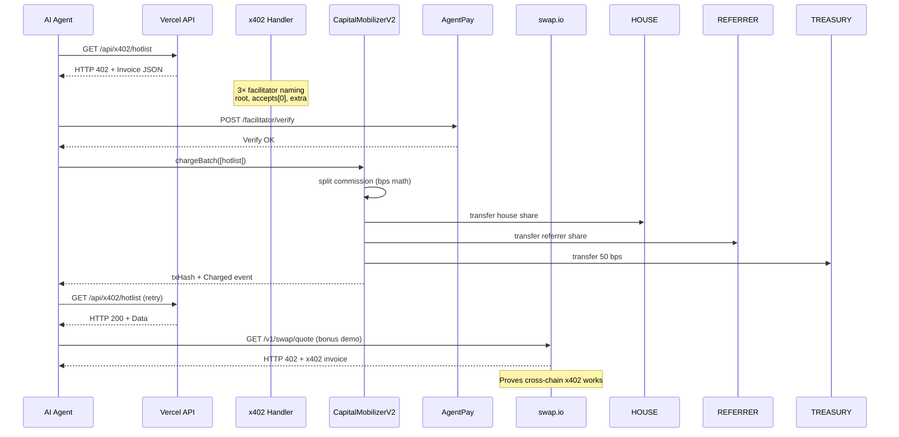

# AutoTasker Hub — Architecture Diagrams

## System Architecture (Mermaid)



## x402 Payment Flow (Sequence)



## Commission Split Math

```
gross = amount × 10000 / channelBps   → exact split per channel

If gross = $1.00, DATA_API channel (100% take):
  ┌─────────────────────────────────────────────┐
  │          gross $1.00                        │
  ├─────────────────────────────────────────────┤
  │ commission    $1.00  (100% of gross)        │
  │   payee       $0.00  (no separate payee)    │
  │   facilitator $0.005  (50 bps → treasury)   │
  │   distributable $0.995                      │
  │     house     $0.8955  (90% of distrib.)    │
  │     referrer  $0.0995  (10% of distrib.)    │
  └─────────────────────────────────────────────┘
  invariant: balance == house + fac + ref ✔
```

## Gas Economics

| Operation | Gas | @ 1 gwei (tQDAY) | USD equiv* |
|-----------|-----|-------------------|------------|
| Single charge | ~221,365 | 0.000221 tQDAY | ~$0.0004 |
| Batch 10 charges | ~237,452 total | **23,745/payment** | ~$0.00004 |
| Batch 100 charges | ≤1M estimated | ~10,000/payment | ~$0.00002 |

*\*$0.0004 assumes tQDAY ≈ $1.80; actual cost depends on gas price at time of tx.*

Batching delivers **91.1% gas savings** per payment vs single charges — this is what makes sub-cent API pricing economically viable on-chain.

## Deployment Architecture

```
                    ┌──────────────────┐
                    │  GitHub Actions  │
                    │  CI/CD Pipeline  │
                    └────────┬─────────┘
                             │
                    ┌────────▼─────────┐
                    │   Vercel CDN     │
                    │  .vercel/app     │
                    │  api/*.js endpoints│
                    └────────┬─────────┘
                             │ HTTPS
              ┌──────────────┼──────────────┐
              │              │              │
     ┌────────▼────┐ ┌──────▼──────┐ ┌────▼────────┐
     │ AgentPay    │ │  x402      │ │  Dashboard  │
     │ Registry    │ │  Paywall   │ │  (public)   │
     └──────┬──────┘ └──────┬─────┘ └─────────────┘
            │               │
     ┌──────▼───────────────▼──────┐
     │    QDay Aevum Testnet       │
     │    chainId 44005            │
     │    RPC: rpc-test.qday.info  │
     └──────┬──────────────┬──────┘
            │              │
   ┌────────▼──────┐ ┌─────▼──────────┐
   │ CapitalMob.   │ │   tUSD8 Token   │
   │ V2 Router     │ │  FiatToken-style│
   │ 0xDf752678... │ │  0x45656983...  │
   └───────────────┘ └────────────────┘
```

---

*Generated for DoraHacks QDay Aevum Builder Challenge #1 submission.*
